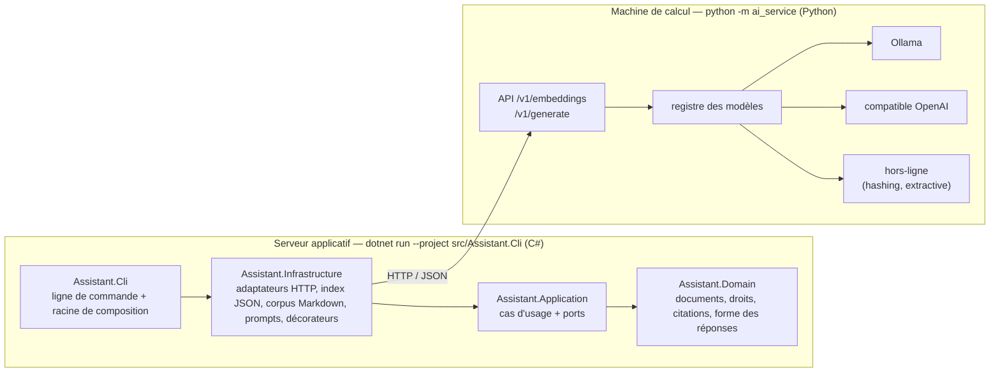

# Assistant documentaire RAG — application C#, modèles d'IA en Python

> **Version complète.** Cette page est celle de la branche `final`, l'application complète. Elle raconte
> tout le cours, corrections comprises. Pour suivre le cours, commencez sur la branche `main`, celle que
> vous obtenez en clonant le dépôt.

Ce dépôt accompagne le cours « Concevoir une application IA maintenable avec la Clean Architecture : jusqu'où
peut-on isoler le modèle ? ».

Vous y trouverez l'assistant documentaire qui sert de fil rouge au cours. L'application est écrite en C# et
les modèles d'IA tournent dans un service écrit en Python. Les deux programmes ne partagent que le contrat
HTTP décrit dans `docs/contrat-http.md` : aucun code commun, aucune bibliothèque commune, pas même le langage.

C'est l'argument de la séquence 2.3 poussé jusqu'au bout. En entreprise, les modèles sont hébergés sur des
machines de calcul et l'application sur des serveurs applicatifs, et les deux équipes n'écrivent pas forcément
dans le même langage.

En quelques mots :

- L'application vise .NET 8 et C# 12, sans aucun paquet tiers : la bibliothèque standard lui suffit
  (`System.Text.Json`, `HttpClient`). Les tests utilisent xUnit.
- Le service IA et l'outil d'import du corpus Service-Public sont écrits en Python 3.11 ou plus, eux aussi
  avec la seule bibliothèque standard.
- Un mode hors-ligne est intégré, avec des embeddings hachés et un générateur extractif. Tout fonctionne sans
  modèle à télécharger ni carte graphique.
- Les vrais modèles passent par [Ollama](https://ollama.com) : `bge-m3` et `llama3.2:3b` dans la configuration
  `config/app-ollama.json`.
- Tout ce que le cours annonce se trouve dans le dépôt : le cahier des charges, le fil rouge étape par étape,
  le banc d'essai, cinq expériences reproductibles, un test statistique, l'exemple jouet de la séquence 1.3 et
  onze ADR. Le tableau « Où la problématique apparaît dans le code », plus bas, relie chacun à sa séquence.

## Par où commencer

Le fil rouge est livré en branches d'étape. Le cours commence sur `main`, la branche que vous obtenez en
clonant le dépôt : c'est l'état du fil rouge au début du cours, celui des séquences S1.1, S1.3 et S2.1. La
branche `etape/sX.Y` est ensuite l'état du fil rouge au début de la séquence X.Y : il y manque exprès ce que
la séquence vous fait écrire, ou la parade de la rupture qu'elle montre. Sa correction, marquée par le tag
`corrige/sX.Y`, est l'état du fil rouge à la fin de la séquence. La branche `final`, celle de cette page,
est au bout du chemin : l'application complète, avec toute sa documentation.

Pour suivre le cours, passez sur `main`. Son README commence par l'installation de votre poste, en S1.1 :

```bash
git switch main
```

Suivez ensuite le cours dans l'ordre de la carte ci-dessous, une branche après l'autre. Le README de chaque
branche dit où en est le fil rouge, ce que vous y faites et comment démarrer.
[`exercices/README.md`](exercices/README.md) donne les énoncés des exercices et la façon de travailler avec
les branches : créer la vôtre, récupérer les tests attendus, comparer votre travail à la correction. S4.3 et
le module 5 se font sur `final`, et le cas pratique de fin de cours (S5.1) est dans
[`cas-pratique/`](cas-pratique/README.md).

La suite de cette page décrit l'application finie, celle de `final`. Le démarrage rapide la fait tourner hors
ligne, une fois votre poste installé avec [`docs/installation.md`](docs/installation.md) : comptez une
vingtaine de minutes pour le mode hors-ligne. La section « Le fil rouge mis sous tension » raconte ensuite le
chemin qui y mène, branche par branche.

### La carte des séquences

| Séquence | Où l'on travaille | Correction |
|---|---|---|
| S1.1, S1.3 et S2.1 | `main` | `corrige/s2.1` |
| S2.2 Cœur sans IA | `etape/s2.2` | `corrige/s2.2` |
| S2.3 Brancher le modèle | `etape/s2.3` | `corrige/s2.3` |
| S3.1 Non-déterminisme | `etape/s3.1` | `corrige/s3.1` |
| S3.2 Les données sont du code | `etape/s3.2` | `corrige/s3.2` |
| S3.3 Frontière métier et modèle | `etape/s3.3` | pas de correction, c'est un débat |
| S4.1 Stratégies d'isolation | `etape/s4.1` | `corrige/s4.1` |
| S4.2 Versionner | `etape/s4.2` | `corrige/s4.2` |
| S4.3 et le module 5 | `final` | `final` |

Pour changer d'étape : `git switch etape/s3.2`, par exemple. Les corrections sont des tags : on les
compare à une branche avec `git diff origin/etape/s3.2 corrige/s3.2`, et on en récupère un fichier avec
`git restore --source corrige/s3.2 -- <fichier>`. La commande de restauration nomme toujours des fichiers,
jamais un dossier.

À partir d'`etape/s2.3`, reconstruisez l'index après chaque changement de branche, le service IA lancé, avec
`dotnet run --project src/Assistant.Cli -- index`. Le dossier `data/` n'est pas versionné, et l'index d'une
autre étape n'a pas forcément le même format. Dans ce cas, l'application refuse de le lire et donne la
commande qui le reconstruit.

## Architecture



La règle de dépendance est tenue de deux façons. D'abord par les références entre projets : un `.csproj` ne
peut pas utiliser ce qu'il ne référence pas, et le domaine ne référence rien. Ensuite par un test,
`InfrastructureLeakTests`, qui inspecte les assemblies compilés jusqu'au code IL : en dehors de `Composition`,
aucun type de `Assistant.Cli` ne doit toucher à l'infrastructure, quelle que soit la façon dont les sources
sont écrites.

Ce test est nécessaire parce que `Assistant.Cli` référence l'infrastructure, dont il a besoin pour assembler
l'application dans `Composition`. Le compilateur ne l'empêche donc pas de s'en servir ailleurs, et c'est le
test qui y veille. Il attrape les erreurs, pas la malveillance.

Pour lire le JSON, la ligne de commande compile sa propre copie des fichiers de `src/Shared/`. Elle n'a donc
pas besoin de nommer l'infrastructure pour cela.

```
src/Assistant.Domain/           entités et règles métier (AccessPolicy, Citations, OutputRules), sans aucune référence
src/Assistant.Application/      ports (IEmbedder, IGenerator, IVectorIndex…), cas d'usage (IndexCorpus, SearchPassages,
                                AskQuestion, CheckStatus), instantanés (RecordSnapshot, SnapshotComparer) et le
                                décorateur de validation de sortie (OutputValidatingGenerator), qui porte une règle
                                métier
src/Assistant.Infrastructure/   adaptateurs (HttpEmbedder, HttpGenerator, MarkdownCorpus, ParagraphSplitter,
                                JsonVectorIndex, FilePromptRepository, JsonSnapshotStore, SystemClock) et décorateurs
                                (cache, journal, tentatives)
src/Assistant.Cli/              Program (les commandes index, ask, status, snapshot, benchmark, experience, serve),
                                HttpApi (l'API HTTP de l'application), Composition (le seul endroit qui connaît tout),
                                AppConfig, Benchmark, Experiments
src/Shared/                     TextFiles et JsonText, la lecture stricte de l'UTF-8 et du JSON : ni un projet ni une
                                couche, mais un même source compilé dans Assistant.Infrastructure et dans Assistant.Cli
tests/Assistant.Tests/          tests xUnit : domaine, cas d'usage avec doubles, adaptateurs, contrat HTTP contre un faux
                                service, API HTTP contre des doubles, règle de dépendance, test statistique (S3.1),
                                calculs du banc, noms de tests cités par la documentation
exemples/s1.3-transfert-naif/   le transfert naïf en 150 lignes environ : port dans le domaine et substitution du
                                générateur
exercices/                      énoncés et corrigés des exercices de code (S2.2, S2.3, S3.1, S4.1), à faire sur les
                                branches d'étape
cas-pratique/                   S5.1 : une version mal structurée du fil rouge à rendre maintenable, le cœur fourni
                                (coeur/), l'énoncé, la grille et le corrigé
ai_service/                     le service IA en Python (registre des modèles, backends Ollama, compatible OpenAI et
                                hors-ligne)
tools/import_service_public.py  importe dans corpus/service-public/ les fiches Service-Public (XML de la DILA)
tests_python/                   tests Python du service IA et de l'outil d'import (bibliothèque standard)
config/app.json                 mode hors-ligne, corpus Solvéo
config/app-ollama.json          vrais modèles, corpus réduit (50 fiches)
config/app-ollama-complet.json  vrais modèles, corpus complet (322 fiches)
config/ai_service.toml          les modèles que sert le service IA
prompts/answer.json             le prompt versionné (answer-v2.json est la variante de la séquence 3.3)
corpus/solveo/                  9 documents fictifs de l'entreprise Solvéo
corpus/service-public-reduit/   50 fiches réelles de Service-Public, le corpus du cours
corpus/service-public/          322 fiches sous Licence Ouverte 2.0, pour les expériences à l'échelle
eval/questions*.json            les jeux de questions
eval/resultats/                 les rapports du banc et des expériences
docs/contrat-http.md            le contrat entre les deux programmes, la seule chose qu'ils partagent
docs/cahier-des-charges.md      le besoin auquel répond l'assistant, point de départ de la séquence 2.1
docs/decoupage.md               le découpage de l'application en couches et en projets, corrigé de la séquence 2.1
docs/gabarit-*.md               les gabarits à remplir en S2.1 (découpage) et en S4.2 (artefacts)
docs/adr/                       les onze décisions d'architecture
docs/artefacts.md               les sept artefacts à versionner ensemble
```

## Démarrage rapide (hors-ligne)

Il vous faut le [SDK .NET 8](https://dotnet.microsoft.com/download/dotnet/8.0) et Python 3.11 ou plus. Ouvrez
deux terminaux à la racine du dépôt : toutes les commandes se lancent depuis là.

Dans le premier terminal, démarrez le service IA (Python) et laissez-le tourner :

```bash
python -m ai_service
```

Dans le second, compilez l'application (C#), construisez l'index, puis posez vos questions :

```bash
dotnet build src/Assistant.Cli
dotnet run --project src/Assistant.Cli -- index
dotnet run --project src/Assistant.Cli -- ask "Combien de jours de télétravail par semaine ?" -v
dotnet run --project src/Assistant.Cli -- ask "Quelle est la fourchette de salaire d'un consultant senior ?" --user alice   # la grille (RH) est écartée avant le prompt
dotnet run --project src/Assistant.Cli -- ask "Quelle est la fourchette de salaire d'un consultant senior ?" --user bruno   # autorisé
dotnet run --project src/Assistant.Cli -- status
dotnet run --project src/Assistant.Cli -- index --if-stale     # réindexe seulement si status dit « à refaire »
```

`index` construit l'index du corpus et `ask` pose une question. Avec `-v`, la réponse est suivie de sa trace
complète. `status` vérifie que l'index correspond toujours au corpus, au découpage et au modèle servi, et
`index --if-stale` ne reconstruit l'index que si `status` le juge à refaire.

Les deux questions sur les salaires montrent les droits d'accès à l'œuvre. La grille des salaires est réservée
aux RH et à la direction. Pour `alice`, elle est filtrée avant même la construction du prompt, et la réponse
vient d'une fiche publique : ajoutez `-v` pour le voir. L'utilisateur `bruno` fait partie des RH : il a accès
à la grille.

### La ligne de commande en pratique

Écrivez toujours la commande d'abord, puis ses options. Une option inconnue, abrégée ou placée au mauvais
endroit est refusée, jamais ignorée en silence. Si une question commence par un tiret, placez `--` devant pour
qu'elle ne soit pas prise pour une option : `ask -- -télétravail`.

Quelques options utiles : `--user <nom>` choisit l'utilisateur (alice par défaut), `--json` donne la sortie de
`ask` et de `status` en JSON, et `-v` affiche aussi le journal des décorateurs. Pour `snapshot record`,
`--questions <fichier>` désigne le jeu de questions et `--limit N` n'en garde que les N premières.

Les codes de retour sont utiles dans un script. Une commande renvoie 0 quand tout s'est bien passé et 1 en cas
d'erreur, y compris une saisie invalide. `status` renvoie 2 quand l'index est à refaire, et 3 quand le modèle
servi n'a pas pu être vérifié parce que le service IA a échoué ou ne répond pas. `index --if-stale` renvoie
lui aussi 3 dans ce dernier cas.

Trois variables d'environnement peuvent servir :

- `ASSISTANT_CONFIG` désigne le fichier de configuration quand `--config` n'est pas donné.
- `AI_SERVICE_URL` donne l'adresse du service IA, pour un déploiement sur deux machines. Elle remplace
  `base_url`, qui doit malgré tout rester présente et valide dans le fichier de configuration.
- `ASSISTANT_LOG=INFO` affiche le journal des décorateurs, comme `-v`.

La configuration se trouve dans `config/*.json`. Elle est lue strictement : le fichier doit être en UTF-8 et
en JSON valide, et une anomalie comme une clé en double est refusée dès le chargement, avec le nom du fichier.
JSON n'ayant pas de commentaires, une clé qui commence par `_` en tient lieu, à n'importe quel niveau du
fichier.

### Les deux verdicts de la problématique

Ces deux commandes montrent deux éléments de réponse à la question du cours. Ce sont des constats à
discuter, pas une conclusion : la séquence 5.3 y revient. On peut changer de modèle de génération sans
rien toucher d'autre. Changer de modèle d'embeddings, en revanche, est refusé explicitement tant que
l'index n'a pas été reconstruit.

```bash
# Changer le modèle de génération : aucun problème, même index
dotnet run --project src/Assistant.Cli -- ask "Combien de jours de congés ?" --generation-model extractive-bruite -v

# Changer le modèle d'embeddings : refus explicite, il faut réindexer
dotnet run --project src/Assistant.Cli -- ask "Combien de jours de congés ?" --embedding-model hashing-512
```

### Instantanés

Un instantané enregistre les réponses de l'assistant à un jeu de questions. On en fige un, on change une seule
chose, on en enregistre un second, puis on compare les deux pour mesurer la dérive :

```bash
dotnet run --project src/Assistant.Cli -- snapshot record reference --limit 8
dotnet run --project src/Assistant.Cli -- snapshot record bruite --limit 8 --generation-model extractive-bruite
dotnet run --project src/Assistant.Cli -- snapshot compare reference bruite
```

### Banc d'essai et expériences

Le banc d'essai et les expériences mesurent au lieu de vérifier un résultat attendu. Ils fonctionnent
hors-ligne comme avec de vrais modèles :

```bash
dotnet run --project src/Assistant.Cli -- benchmark --embedding hashing hashing-512 --generation extractive extractive-bruite --runs 3
dotnet run --project src/Assistant.Cli -- experience cace-decoupage                        # découpage de 800 à 300 caractères : la dérive
dotnet run --project src/Assistant.Cli -- experience changement-embeddings --other hashing-512
dotnet run --project src/Assistant.Cli -- experience changement-generateur --other extractive-bruite
dotnet run --project src/Assistant.Cli -- experience prompt-v2
dotnet run --project src/Assistant.Cli -- experience stabilite --runs 3 --generation-model extractive-bruite
```

Chaque expérience change une seule chose, enregistre deux instantanés et écrit son rapport dans
`eval/resultats/exp-<nom>-<AAAAMMJJ-HHMMSS>/rapport.md`. Le banc, lui, écrit dans
`eval/resultats/<AAAAMMJJ-HHMMSS>/`.

Seule `stabilite` ne change rien : elle pose plusieurs fois les mêmes questions, trois fois ici, pour
mesurer ce qui bouge quand la configuration reste la même. La commande ci-dessus lui fait utiliser
`extractive-bruite`, qui simule hors-ligne les défauts d'un vrai modèle. Avec `extractive`, le générateur
par défaut, aucune réponse ne bouge, car il est déterministe.

Quand aucun seuil de pertinence n'est configuré pour un modèle d'embeddings, c'est la valeur `default` qui
s'applique, et l'expérience le signale dans la console comme dans son rapport (ADR 0004). Pour
`changement-embeddings` et `changement-generateur`, l'alias passé à `--other` est d'abord vérifié auprès du
service IA (`GET /v1/models`). Il doit être servi et du bon type, sinon l'expérience s'arrête avant de
construire le moindre index.

Le banc, les expériences et `snapshot record` lisent un jeu de questions, comme `eval/questions.json`. Chaque
question a un `id` unique, son texte, `question`, et l'utilisateur qui la pose, `user` (alice s'il n'est pas
indiqué). Elle peut aussi dire ce qu'on attend d'elle : `answerable` (`true` ou `false`) indique si la réponse
existe dans un document accessible à l'utilisateur, `expected_documents` et `expected_keywords` donnent les
documents et les mots-clés attendus, et `forbidden_documents` les documents que la réponse ne doit jamais
citer pour cet utilisateur.

Aucune autre clé n'est permise, sauf celles qui commencent par `_` : ce sont des commentaires, comme dans la
configuration. Une faute de frappe dans un nom de clé est donc signalée au lieu de vider une attente en
silence. Le fichier est lu aussi strictement que la configuration, et une erreur indique le fichier, le numéro
de la question et, s'il y a lieu, le champ en cause.

### Servir l'application en HTTP

L'application peut aussi être servie en HTTP, sur le port 8000 par défaut (`--port` permet d'en changer) :

```bash
dotnet run --project src/Assistant.Cli -- serve                      # port 8000
curl http://127.0.0.1:8000/health
curl -X POST http://127.0.0.1:8000/v1/ask -H "Content-Type: application/json" -d '{"user": "alice", "question": "Combien de jours de teletravail ?"}'
curl http://127.0.0.1:8000/v1/status                                 # 200 à jour, 409 à refaire, 503 non vérifié
curl -X POST http://127.0.0.1:8000/v1/index -d '{}'                  # reconstruit l'index
```

`/v1/status` répond comme la commande `status` : 200 si l'index est à jour, 409 s'il est à refaire, 503 si le
modèle servi n'a pas pu être vérifié. L'API n'a pas d'authentification : l'utilisateur est celui que déclare
la requête. Elle est prévue pour un réseau interne (voir `docs/installation.md`).

En cas d'erreur, la réponse est un objet JSON de la forme `{"error": {"code": …, "message": …}}`. Le `code`
dit ce qui s'est passé, le `message` en donne le détail :

| HTTP | `code` | Signification |
|---|---|---|
| 400 | `invalid_json` | le corps n'est pas un objet JSON valide en UTF-8. Le JSON est lu strictement : une clé en double, par exemple, est refusée. |
| 400 | `invalid_request` | `user` ou `question` n'est pas une chaîne, ou la requête est mal formée, par exemple un codage de transfert autre que `chunked` ou un corps plus court que son `Content-Length` |
| 400 | `invalid_question` | question vide ou absente |
| 403 | `unknown_user` | utilisateur absent de la configuration, ou non indiqué |
| 404 | `not_found` | route inconnue |
| 405 | `method_not_allowed` | la route existe, mais pas pour cette méthode : l'en-tête `Allow` donne les méthodes permises |
| 409 | `index_unusable` | pas d'index, index construit avec un autre modèle d'embeddings, ou index reconstruit pendant la question (le message invite alors à la reposer) |
| 413 | `payload_too_large` | corps de plus de 16 Mio sur `/v1/index` ou `/v1/ask` |
| 500 | `unreadable_state` | corpus mal formé ou vide, prompt ou index illisible |
| 500 | `index_write_failed` | l'index n'a pas pu être écrit, et l'index en service reste le précédent |
| 500 | `internal_error` | erreur imprévue |
| 502 | `ai_service_error` | le service IA est injoignable, en erreur, ou sa réponse ne respecte pas le contrat |

Certaines requêtes mal formées n'atteignent pas l'application : `HttpListener` les refuse lui-même. La réponse
est alors une page HTML avec son propre statut (400, 411, 413, 414, 501 ou 505), et non le JSON du tableau.
C'est ce qui arrive à un POST sans corps, qui reçoit 411 (« Length Required ») : voilà pourquoi l'exemple de
`/v1/index` envoie `-d '{}'`. Le détail varie entre Windows et Linux.

## Avec de vrais modèles

Installez d'abord Ollama et les modèles en suivant les étapes 5 et 6 de
[`docs/installation.md`](docs/installation.md). Relancez ensuite le service IA, puis :

```bash
dotnet run --project src/Assistant.Cli -- index --config config/app-ollama.json
dotnet run --project src/Assistant.Cli -- ask "Combien de jours dure le congé de paternité ?" --config config/app-ollama.json -v
dotnet run --project src/Assistant.Cli -- benchmark --config config/app-ollama.json --embedding bge-m3 nomic --generation llama3-2-3b --questions eval/questions-service-public.json --validate-with eval/questions-service-public-validation.json --runs 1
```

Les mesures de référence ont été prises sur le corpus réduit, avec `bge-m3` et `llama3.2:3b`, sur une RTX 3070
de 8 Go. Vous les trouverez dans [`eval/resultats/`](eval/resultats/README.md). Celles du corpus complet ne
figurent pas dans le dépôt, mais `config/app-ollama-complet.json` permet de les refaire.

Le temps de réponse se passe dans le service IA, pas dans l'application : le langage de celle-ci ne change
rien aux ordres de grandeur.

### Quels modèles pour quelle machine ?

Voici des ordres de grandeur, à confirmer avec le banc d'essai sur vos machines.

| Machine | Embeddings | Génération | Temps de réponse attendu |
|---|---|---|---|
| 8 Go de RAM, sans GPU | `all-minilm`, `nomic` | `gemma3-1b`, `qwen3-1b7` | de quelques secondes à 20 secondes environ |
| 16 Go de RAM, sans GPU | `nomic`, `mxbai`, `bge-m3` | `llama3-2-3b`, `qwen3-4b`, `gemma3-4b` | de 10 à 40 secondes environ |
| GPU de 6 Go et plus | tous | `mistral-7b` et au-delà | quelques secondes |

La liste des alias disponibles, avec leur description, se trouve dans `config/ai_service.toml`. Le service IA
la donne aussi sur `GET http://127.0.0.1:8100/v1/models`. Pour ajouter un modèle, il suffit d'ajouter un bloc
dans ce fichier : le code ne change pas.

Hors ligne, le générateur `extractive` a trois variantes. `extractive-bruite` imite un modèle imparfait : ses
réponses varient et il oublie parfois de citer. `extractive-variante` reste déterministe, mais choisit pour
certaines questions une autre phrase, toujours citée : il sert à changer de générateur sans Ollama, en S1.3 et
en S2.3. `extractive-bavard` fait précéder sa réponse d'un raisonnement en anglais, comme un modèle qui
réfléchit à voix haute : la validation de sortie de la séquence 4.1 le refuse.

Les modèles `st-*` (sentence-transformers) sont optionnels. Pour vous en servir, installez leurs dépendances
sur la machine du service IA avec `pip install -r requirements-ai-optional.txt`.

## Tests

```bash
dotnet test                                              # tests C#, sans IA ni réseau, dont un test statistique (S3.1)
python -m unittest discover -s tests_python -t .         # tests Python : service IA et outil d'import
```

Les deux commandes doivent se terminer sans échec. Sous macOS et Linux, un test propre à Windows est ignoré :
c'est normal.

## Du transfert naïf au fil rouge

L'exemple de la séquence 1.3 applique le transfert naïf : un port, des adaptateurs, et l'on change de
modèle sans toucher au domaine. Le fil rouge garde ce principe, mais il ne s'arrête pas là.

| L'exemple S1.3 | Le fil rouge |
|---|---|
| Le port `ITextGenerator` est déclaré dans le domaine, à côté d'`Assistant`, qui s'en sert. | Les ports `IEmbedder` et `IGenerator` sont déclarés dans la couche application (`src/Assistant.Application/Ports.cs`). Ce sont les cas d'usage qui ont besoin d'un modèle, pas les entités. Le domaine ne dépend de rien, pas même d'une interface tournée vers l'extérieur. |
| Un seul modèle, le générateur, qui ne laisse rien derrière lui : on change d'alias, et c'est tout. | Le modèle d'embeddings laisse un état dans l'application : l'index. Le fil rouge l'accompagne d'un manifeste, qui donne le modèle, la dimension, l'empreinte du corpus et le découpage. Avec un index construit par un autre modèle, `IndexModelMismatchException` refuse de répondre, et `status` le signale avant la première question (ADR 0003). |
| Un seul programme. | Deux déployables, deux langages et un contrat HTTP. La substitution va jusqu'au langage, mais le couplage par les données, lui, ne disparaît pas (ADR 0009). |

Le transfert naïf n'est pas faux, il est incomplet. Il traite le modèle comme un service sans état. Or
un modèle d'embeddings laisse un état dans l'application, et cet état, c'est l'index. Le reste du cours
fait l'inventaire de ces états (séquences 3.2 et 4.2) et de ce qu'il faut pour les tenir (séquence 4.1).

## Le fil rouge mis sous tension

Le cours part d'une version idéale du fil rouge, où « le modèle est un détail » tient : c'est `corrige/s2.3`.
Il la met ensuite sous tension par trois ruptures. Chacune se voit au début d'une séquence et se pare dans sa
correction : un test qui cesse d'être déterministe en S3.1, une dépendance de données instable en S3.2, un
index à reconstruire en S4.2. Entre les deux dernières, S3.3 pose la question de la frontière entre le métier
et le modèle, et S4.1 distingue isoler la technologie et isoler l'incertitude.

Cette section suit les branches dans l'ordre. Pour chacune, elle dit ce que la séquence montre, la commande
qui le montre, la parade de la correction, et ce que devient le principe : ce qui tient, ce qui se déforme et
ce qui cède. Les commandes se lancent sur la branche du titre, le service IA lancé hors ligne et, à partir
d'`etape/s2.3`, l'index construit. Celles d'une correction se relancent sur son tag, avec
`git switch --detach corrige/s3.1` par exemple, ou sur la branche suivante, qui part de la correction. Les
chiffres sont ceux que ces commandes donnent hors ligne.

Ce sont des constats, pris branche par branche. Ce qu'ils disent de la question du cours, c'est à vous de le
formuler en S5.3.

### `main` : la promesse tient

Il n'y a pas encore d'application, seulement l'exemple de S1.3 : un port `ITextGenerator`, déclaré dans le
domaine, et son adaptateur HTTP. On y change de générateur par un argument :

```bash
dotnet run --project exemples/s1.3-transfert-naif -- generate fake
dotnet run --project exemples/s1.3-transfert-naif -- generate extractive-variante
```

`Assistant.cs` ne bouge pas d'une commande à l'autre. La correction, `corrige/s2.1`, écrit en code le
découpage de S2.1 : quatre projets dont chacun ne référence que la couche suivante vers l'intérieur, les
entités du domaine et les ports de l'application. Des tests d'architecture vérifient la règle de dépendance.

Ici, tout tient : le modèle n'est qu'un port, et le changer ne touche pas au domaine.

### `etape/s2.2` : un cœur sans modèle

La séquence fait écrire le cœur : les règles des droits et des citations, et le cas d'usage qui répond à une
question. Il se teste avec des doubles, sans modèle, sans réseau et sans disque, et les tests d'architecture
vérifient qu'il ne dépend de rien d'extérieur :

```bash
dotnet test --filter "FullyQualifiedName~ArchitectureTests"
```

Un `HttpClient` glissé dans le cœur fait échouer `The_core_does_not_touch_the_network`. La correction,
`corrige/s2.2`, écrit ce cœur dans sa version la plus simple : un seul seuil, une seule génération, et un
refus sans appel au modèle quand aucun passage n'est pertinent.

Rien ne cède non plus. `corrige/s2.2` reste le point de comparaison du cours : la séquence 5.3 mesure
jusqu'où ce cœur a bougé.

### `etape/s2.3` : la version idéale

L'application est complète, sauf son adaptateur de génération : un bouchon arrête `ask` dès qu'il faut
générer. La séquence fait écrire `HttpGenerator`, et la correction, `corrige/s2.3`, le branche sans toucher au
cœur. Sur le domaine et l'application, le diff de la correction est vide :

```bash
git diff origin/etape/s2.3 corrige/s2.3 -- src/Assistant.Domain src/Assistant.Application
```

On change alors de générateur sur le même index, sans réindexer :

```bash
dotnet run --project src/Assistant.Cli -- ask "Combien de jours de télétravail par semaine ?" --generation-model extractive-variante -v
dotnet run --project src/Assistant.Cli -- ask "En combien de temps un incident P1 est-il pris en charge ?" --generation-model extractive-variante -v
```

`extractive-variante` répond moins bien sur la première question et mieux sur la seconde, toujours en citant
sa source, et le cœur ne bouge pas. Ces questions ont été choisies pour montrer les deux sens : sur d'autres,
quand la variante ne répond pas comme `extractive`, elle répond le plus souvent moins bien. Les droits tiennent
aussi : la grille des salaires n'entre jamais dans le prompt d'alice. À la question « Quelle est la fourchette
de salaire d'un consultant senior ? », alice reçoit pourtant une phrase sans rapport, tirée de la fiche des
congés, avec un score de 0,154 pour un seuil de 0,15. Ce seuil trop bas annonce la séquence 3.2.

C'est la version idéale du cours, et tout y tient. Avec un vrai modèle, une réponse peut pourtant changer d'un
passage à l'autre, et c'est là que commence la séquence 3.1.

### `etape/s3.1` : première rupture, le test non déterministe

La branche n'ajoute que des instruments de mesure : les instantanés, et l'expérience `stabilite`, qui pose
plusieurs fois les mêmes questions sans rien changer. `extractive-bruite` imite un modèle imparfait, qui tire
sa phrase au hasard et oublie parfois sa citation :

```bash
dotnet run --project src/Assistant.Cli -- experience stabilite --runs 3 --generation-model extractive-bruite
```

Environ une réponse sur deux change d'un passage à l'autre, avec une quinzaine de changements de statut entre
`answered` et `unsourced`, et ces chiffres varient d'une série à l'autre. Un test qui attend une réponse
exacte échoue alors au hasard.

La correction, `corrige/s3.1`, sépare ce qui est déterministe de ce qui ne l'est pas. La recherche filtrée par
les droits devient un cas d'usage à part, `SearchPassages`, testé par assertion. La génération a droit à une
seconde tentative quand ses citations échouent, et une graine peut fixer son tirage. Sans graine, la même
mesure montre un texte qui change toujours, mais des réponses non sourcées devenues rares. Avec `--seed 7`,
plus rien ne bouge. Ce qui tire au hasard se teste par une évaluation statistique, dont la tolérance et le
risque de faux échec sont calculés dans `tests/Assistant.Tests/StatisticalTests.cs`.

Le port tient, et la règle de dépendance aussi. Le cœur, lui, se déforme : le cas d'usage se coupe en deux
pour isoler la part qui tire au hasard, la requête de génération porte une graine, et la trace compte les
tentatives. Le modèle reste remplaçable, mais il impose la façon de le tester.

### `etape/s3.2` : deuxième rupture, les données sont du code

L'index ne sait pas quel modèle l'a construit. Le service IA renvoie pourtant le modèle et la dimension depuis
S2.3, mais le port les jette : `IEmbedder` ne rend que des vecteurs. Chaque fichier de configuration n'a, de
plus, qu'un seul seuil. Trois manipulations le montrent.

D'abord le découpage. Les morceaux passent de 800 à 300 caractères entre deux instantanés : 8 réponses sur 24
changent, soit 33 %, et 5 changent de statut.

Ensuite le modèle d'embeddings, changé sans réindexer :

```bash
dotnet run --project src/Assistant.Cli -- ask "Quelle est la capitale de l'Australie ?" -v --embedding-model hashing-stem4
```

`hashing-stem4` donne des vecteurs de la même dimension que `hashing`, mais calculés autrement. Aucune erreur
n'apparaît, et l'assistant répond « Charte d'utilisation des outils informatiques [1] », avec un score de
0,168, là où `hashing` refusait à juste titre. Sur les 24 questions, 18 réponses changent. Avec `hashing-512`,
la dimension change et l'erreur est franche, mais elle ne dit pas ce qu'il faut faire.

Enfin le seuil. Sur le corpus réduit, avec `hashing`, le seuil de 0,65, calibré pour `bge-m3`, ne laisse
l'assistant répondre qu'à 9 des 32 questions qui ont une réponse accessible. Le seuil de 0,15 le fait répondre
aux 32, mais aussi à 9 des 10 questions sans réponse accessible.

La correction, `corrige/s3.2`, change la forme des ports. `IEmbedder` rend un `EmbeddingBatch`, avec le modèle
et la dimension, et `IGenerator` une `Generation`, avec le modèle. L'index enregistre un manifeste, et
`SearchPassages` refuse une question vectorisée par un autre modèle en demandant de réindexer. Le seuil
devient une table par modèle d'embeddings : avec sa propre valeur, 0,45, `hashing` répond à 30 des 32
questions répondables et refuse 8 des 10 autres. La parade se lit sur les fichiers qui la montrent :

```bash
git diff origin/etape/s3.2 corrige/s3.2 -- src/Assistant.Application/Ports.cs src/Assistant.Application/SearchPassages.cs src/Assistant.Application/IndexCorpus.cs src/Assistant.Domain
```

Le modèle se choisit toujours par une option, et la panne silencieuse devient un refus explicite. Les ports,
eux, se déforment pour laisser passer l'identité du modèle, et la trace du domaine nomme désormais les
modèles. Enfin, quelque chose cède : un modèle d'embeddings ne se remplace plus sans réindexer, et le seuil,
un réglage du métier, dépend des poids du modèle comme du corpus.

### `etape/s3.3` : la frontière entre le métier et le modèle

Cette branche n'a pas de correction : la séquence est un débat, et rien n'y tranche. Elle ajoute un second
prompt, `prompts/answer-v2.json`, et l'expérience `prompt-v2`, qui compare les deux. Avec Ollama :

```bash
dotnet run --project src/Assistant.Cli -- experience prompt-v2 --generation-model llama3-2-3b
```

Avec un vrai modèle, changer les consignes change les réponses sans qu'une ligne de code bouge. Hors ligne, la
dérive vaut 0 %, parce qu'`extractive` ignore les consignes. `experience cace-decoupage` rejoue de son côté la
rupture de S3.2 : un tiers des réponses changent, et la part des refus justes tombe de 0,80 à 0,40.

La question, elle, reste ouverte. Le seuil de pertinence est une règle métier dont la valeur dépend des poids
du modèle. Les consignes du prompt, répondre en français, en trois phrases au plus, en citant les passages,
sont des exigences du métier écrites dans un texte réglé pour un modèle. Le prompt est-il de la configuration
ou de la logique métier ? Le modèle est-il un détail, une entité, ou une catégorie que le schéma classique de
la Clean Architecture ne prévoit pas ?

### `etape/s4.1` : isoler la technologie, ou l'incertitude

Des décorateurs entourent maintenant les ports : un cache pour les embeddings des questions, un journal des
appels, et de nouvelles tentatives quand le service IA a une panne passagère. Ils ne savent rien de ce qu'est
une bonne réponse. L'alias `extractive-bavard` fait précéder sa réponse d'un raisonnement en anglais :

```bash
dotnet run --project src/Assistant.Cli -- ask "Combien de jours de télétravail par semaine ?" --generation-model extractive-bavard -v
```

La réponse commence par « Okay, let me check the documents. », se termine par la citation [1] et reçoit le
statut `answered`. Aucun décorateur ne l'arrête.

La correction, `corrige/s4.1`, ajoute la validation de la sortie. `OutputValidatingGenerator`, un décorateur
de l'application, applique au texte la règle du domaine `OutputRules`, et un rejet compte comme une tentative
ratée. La même question est alors refusée après deux tentatives, avec le statut `unsourced`.

Les décorateurs tiennent leur promesse : ils s'empilent autour des ports sans que les cas d'usage le sachent,
et le modèle reste remplaçable. Mais ce qui isole l'incertitude n'est pas un adaptateur de plus. Ce sont des
règles du domaine et de l'application : les droits filtrés avant le prompt, les citations vérifiées, les
tentatives du cas d'usage et la validation de la forme.

### `etape/s4.2` : troisième rupture, l'index à reconstruire

Le manifeste de l'index connaît le modèle d'embeddings et sa dimension, mais ni l'état du corpus, ni le
découpage, ni la date. La trace d'une réponse nomme les modèles, mais ni l'index ni la version du prompt, qui
n'en a pas. Après `index`, remplacez « deux jours » par « trois jours » dans `corpus/solveo/teletravail.md` :
l'assistant répond toujours qu'on peut télétravailler « jusqu'à deux jours par semaine », et rien ne le
signale. Remplacez ensuite « Question : » par « Demande : » dans `prompts/answer.json`, entre deux
instantanés :

```bash
dotnet run --project src/Assistant.Cli -- snapshot record avant
# remplacement dans prompts/answer.json
dotnet run --project src/Assistant.Cli -- snapshot record apres
dotnet run --project src/Assistant.Cli -- snapshot compare avant apres
```

La comparaison mesure 62 % de dérive, et elle répond pourtant « aucune : même configuration des deux côtés ».
Cette dérive tient à un couplage du générateur de test, qui cherche le mot « Question : » dans le prompt. Ce
qui compte, c'est que rien ne dit que le prompt a changé.

La correction, `corrige/s4.2`, donne une identité à chaque artefact. Le manifeste porte un identifiant,
l'empreinte du corpus, le découpage et la date de construction. Les prompts ont une version, complétée par une
empreinte de leur contenu, et chaque réponse nomme l'index et la version du prompt qui l'ont produite.
`status` dit si l'index correspond encore au corpus, au découpage et au modèle servi, et se termine avec le
code 2 quand il est à refaire. `index --if-stale` ne le reconstruit que dans ce cas. La même comparaison nomme
alors `prompt_version` comme seule différence de configuration, et `docs/artefacts.md` range les sept
artefacts qui se versionnent ensemble.

Le modèle reste derrière ses ports, et le cœur ne touche toujours pas au réseau. Ce qui cède, c'est l'idée
d'un modèle qui se change seul : le code, le corpus, le découpage, l'index, les prompts et les deux modèles
forment un ensemble qui se versionne d'un bloc. Le cœur porte maintenant l'identité de l'index et celle du
prompt, avec une horloge pour dater l'index.

### `final` : ce qui s'ajoute après le cours

`final` est la correction de S4.2, plus un commit « Compléments ». Ce commit n'apporte aucune rupture
nouvelle. Il ajoute les ADR, les mesures de référence prises avec de vrais modèles, le cas pratique et la
commande `serve`, qui sert l'application en HTTP. `serve` impose de la concurrence, car l'index peut être reconstruit pendant
qu'une question est en cours. Cela touche le cœur. La recherche ne porte plus que sur l'index dont elle a
contrôlé le modèle, et deux exceptions s'ajoutent : l'une quand l'index a été remplacé pendant la recherche,
l'autre quand il n'a pas pu être écrit. C'est un besoin classique de tout service, qui ne tient pas à l'IA.
C'est pourquoi les mesures de S4.3 et de S5.3 s'arrêtent à `corrige/s4.2`.

### Mesurer ce que les parades ont coûté

Les tags ne bougent plus, si bien que ces mesures se refont à l'identique chez vous.

En S4.3, le coût des parades se lit entre la version idéale et la dernière correction :

```bash
git diff --stat corrige/s2.3 corrige/s4.2 -- src tests
```

71 fichiers changent : 6 836 lignes ajoutées et 294 retirées, dont 3 232 lignes ajoutées dans `src` et 3 604
dans les tests. Le banc d'essai et les expériences, `src/Assistant.Cli/Benchmark.cs` et
`src/Assistant.Cli/Experiments.cs`, comptent à eux deux 1 190 lignes. Refaites ensuite la mesure d'une
correction à la suivante, par exemple entre `corrige/s3.1` et `corrige/s3.2`, pour voir ce que chaque séquence
a coûté.

L'autre pôle de la comparaison est `cas-pratique/depart/Program.cs` : un assistant RAG d'environ 250 lignes,
tout dans un seul fichier, qui répond lui aussi aux questions des salariés en citant ses sources. Mettez-le en
regard des chiffres de `src` pour juger, scénario par scénario, quand une architecture aussi simple suffirait.

Le coût de `serve` se lit à part :

```bash
git diff --stat corrige/s4.2 origin/final -- src tests
```

29 fichiers changent : 2 289 lignes ajoutées et 77 retirées. `src/Assistant.Cli/HttpApi.cs` en compte 351,
`tests/Assistant.Tests/HttpApiTests.cs` 705 et `tests/Assistant.Tests/IndexConcurrencyTests.cs` 480. C'est un
point de comparaison pour la discussion de S4.3.

En S5.3, relisez cette section, puis mesurez jusqu'où le cœur a bougé depuis sa version sans IA de S2.2 :

```bash
git diff corrige/s2.2 corrige/s4.2 -- src/Assistant.Domain src/Assistant.Application
```

Avec `--stat`, la même commande compte 12 fichiers, dont six nouveaux : 720 lignes ajoutées et 49 retirées. Le
diff complet vous laisse juger, ligne à ligne, ce qui tient au modèle et ce qui tient au métier.

## Pourquoi deux langages

Écrire l'application en C# montre plusieurs choses qu'une application en Python, comme le service IA, ne
montrerait pas :

| Point | Application en Python | Application en C# (ce dépôt) |
|---|---|---|
| La règle de dépendance | vérifiée seulement par un test qui analyse les `import` | imposée par le compilateur (références de projets), et vérifiée en plus par un test |
| Le service IA | même langage que l'application : on *pourrait* tricher en important `ai_service` | autre langage : tricher est impossible, seul le contrat HTTP existe |
| L'index JSON | écrit et lu par Python | écrit et lu en C#, avec les vecteurs du service Python : c'est le modèle d'embeddings qui doit correspondre, pas le langage |
| Les ports | `Protocol` (typage structurel) | `interface` (typage nominal) : un adaptateur *déclare* qu'il implémente le port |
| Les décorateurs | des classes qui imitent le port | des classes qui implémentent l'interface : le compilateur garantit qu'on peut les substituer |

Le prix à payer, ce sont deux environnements à installer, .NET 8 et Python 3.11 ou plus (voir
`docs/installation.md`). L'ADR 0009 détaille ce choix.

Certaines choses manquent volontairement. Il n'y a pas de service IA en C#, parce qu'il effacerait l'argument.
Il n'y a pas non plus de base vectorielle : l'index JSON est la base vectorielle locale du cours, en un seul
fichier (ADR 0007). Enfin, il n'y a pas de réentraînement, car un RAG n'entraîne rien : il se réindexe (voir
`docs/artefacts.md`).

## Où la problématique apparaît dans le code

| Séquence | Sujet | Dans le code |
|---|---|---|
| S1.3 | Le transfert naïf | `exemples/s1.3-transfert-naif/` : le port est placé dans le domaine, et l'on change de générateur sans toucher au domaine, hors ligne avec `extractive-variante`. |
| S1.3 et S2.3 | Le modèle derrière un port | `IEmbedder` et `IGenerator` dans la couche application (`src/Assistant.Application/Ports.cs`), leur adaptateur dans `src/Assistant.Infrastructure/HttpAiClient.cs`, ADR 0001 et 0009 |
| S2.1 | Le cahier des charges | `docs/cahier-des-charges.md`, le découpage à proposer sur `docs/gabarit-decoupage.md` et son corrigé `docs/decoupage.md`, les règles métier (droits, citations, forme des réponses) dans `src/Assistant.Domain/Rules.cs`, le corpus Solvéo (`corpus/solveo/`), et pour les vrais modèles `corpus/service-public-reduit/` (50 fiches) |
| S2.2 | Un cœur testable sans IA | `tests/Assistant.Tests/AskQuestionTests.cs` avec les doubles de `tests/Assistant.Tests/Fakes.cs`, `ArchitectureTests`, et l'exercice `exercices/s2.2-coeur-metier/`, à faire sur la branche `etape/s2.2` |
| S2.3 | Substituer le générateur | `--generation-model` change de générateur en gardant le même index, sans rien d'autre à modifier. `experience changement-generateur` en mesure l'effet. L'exercice `exercices/s2.3-adaptateur-de-generation/` fait écrire `HttpGenerator`. |
| S3.1 | Le non-déterminisme | la vérification déterministe des citations (`src/Assistant.Domain/Rules.cs`), les tentatives, `tests/Assistant.Tests/StatisticalTests.cs` (tolérance et faux échec calculés), `benchmark` (stabilité, `--validate-with`), `experience stabilite`, et l'exercice `exercices/s3.1-evaluation-statistique/` |
| S3.2 | Les données sont du code | `IndexModelMismatchException` (dans `SearchPassages`), le découpage inscrit dans le manifeste, un seuil par modèle et par corpus (`config/app-ollama*.json`), `experience cace-decoupage` et `experience changement-embeddings` |
| S3.3 | Le prompt | `prompts/answer.json`, dont la version et une empreinte du contenu figurent dans chaque trace, `--prompt answer-v2`, `experience prompt-v2`, ADR 0005 |
| S4.1 | Isoler l'incertitude | les droits filtrés avant le prompt, `Composition.Decorate()` (cache, journal, tentatives, validation de forme dans `src/Assistant.Application/Guards.cs`), ADR 0006 et 0008, et l'exercice `exercices/s4.1-decorateur-de-validation/` |
| S4.2 | Versionner ensemble | `IndexManifest`, `AnswerTrace`, `status` (`CheckStatus`), `index --if-stale`, `snapshot record` et `snapshot compare`, le port `IClock`, le gabarit `docs/gabarit-artefacts.md` et son corrigé `docs/artefacts.md` (sept artefacts) |
| S4.3 | Les limites | un index JSON à recherche exhaustive, aucune base vectorielle, aucun paquet tiers (ADR 0007). Le coût des parades se mesure de `corrige/s2.3` à `corrige/s4.2`, et celui de `serve` à part, face au programme d'un seul fichier de `cas-pratique/depart/` (voir « Mesurer ce que les parades ont coûté », plus haut). Reste une question à débattre : quatre projets .NET et un service Python pour une ligne de commande, est-ce trop ? |
| S5.1 et S5.2 | Le cas pratique | `cas-pratique/` : un programme de départ mal structuré (`depart/Program.cs`), le cœur fourni (`coeur/`), l'énoncé, la grille d'évaluation et le corrigé (`corrige.md`), qui prend ce dépôt pour solution de référence |
| S5.3 | Des éléments de réponse | Relisez « Le fil rouge mis sous tension » et mesurez jusqu'où le cœur a bougé depuis `corrige/s2.2`. Deux verdicts, à confronter à votre propre réponse (voir « Les deux verdicts de la problématique », plus haut). Changer de générateur ne demande aucune autre modification, même si les réponses changent, et l'application C# ne parle au service IA en Python que par le contrat HTTP (`docs/contrat-http.md`, ADR 0009). Changer de modèle d'embeddings oblige au contraire à réindexer : le couplage par les données demeure. Le seuil dépend lui aussi de ce modèle, et le prompt est réglé pour un générateur. Jusqu'où peut-on alors dire que le modèle est isolé ? La question reste ouverte. |

## Limites connues

- `main`, les branches d'étape et les tags de correction accompagnent `final` et se publient avec elle. Ils
  gardent exprès des défauts que `final` n'a pas, comme la panne silencieuse que montre `etape/s3.2` : seule
  `final` sert de référence (ADR 0011).
- Les temps de réponse sans carte graphique n'ont pas été mesurés (voir `docs/installation.md`).
- L'API HTTP traite les requêtes une par une. Une génération longue retarde donc `/health`, et un client qui
  annonce un corps sans jamais l'envoyer bloque toute l'API : environ deux minutes sous Windows, où http.sys
  finit par couper la connexion, et sans limite sous Linux. C'est suffisant pour le cours, mais à savoir avant
  un déploiement.
