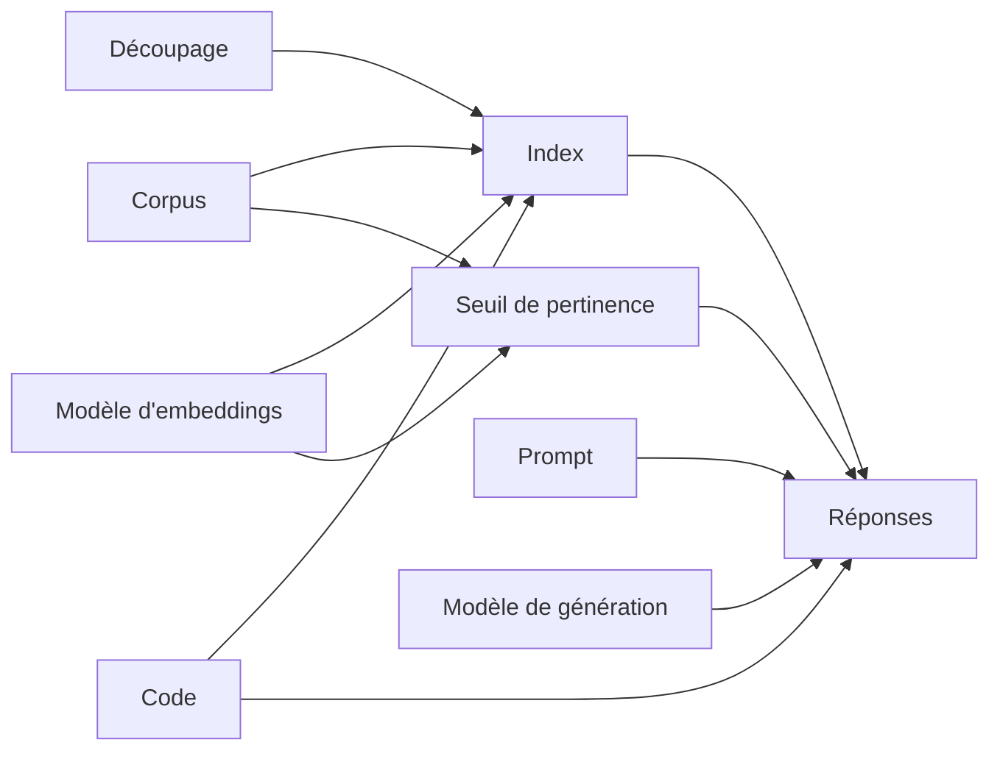

# Versionner ensemble : les artefacts d'un assistant RAG (séquence 4.2)

Une application de gestion classique, c'est du code et une base de données. Un assistant RAG, lui,
dépend de sept artefacts. Ils changent à des rythmes différents, sont entretenus par des personnes
différentes, et certains dépendent des autres sans que rien ne le signale. Seul le code est
versionné naturellement par Git.

## Les sept artefacts

| Artefact | Où il vit | Qui le change | Ce qui en dépend | Comment on le trace | Dans quelle couche |
|---|---|---|---|---|---|
| Code | `src/Assistant.*` (C#), `ai_service/` et `tools/` (Python) | les développeurs | tout | Git | toutes, et le service IA à part |
| Corpus | `corpus/<nom>/*.md` | les métiers (RH, juridique…), et la DILA pour le corpus Service-Public, importé par `tools/import_service_public.py` qui attribue aussi les droits | l'index | `corpus_fingerprint` dans le manifeste de l'index, une empreinte des textes et des droits d'accès | hors du code. L'infrastructure le lit (`MarkdownCorpus`), derrière le port `IDocumentSource` |
| Découpage | section `"splitter"` de la configuration | les développeurs | l'index, les seuils | `splitter` dans le manifeste, et `index_id` change avec lui | l'infrastructure (`ParagraphSplitter`), derrière le port `ITextSplitter` |
| Index | `data/index*.json` | personne : il est dérivé | les réponses | `IndexManifest` : `index_id`, modèle concret, dimension, empreinte du corpus, découpage, date | l'infrastructure (`JsonVectorIndex`), derrière le port `IVectorIndex`. Son manifeste est décrit par l'application |
| Prompts | `prompts/*.json` | développeurs ou métiers | les réponses, pas l'index | version déclarée et empreinte du contenu, inscrites dans chaque `AnswerTrace` | hors du code. L'infrastructure les lit (`FilePromptRepository`), derrière le port `IPromptRepository` |
| Modèle d'embeddings | derrière un alias du service IA (`config/ai_service.toml`) | l'équipe qui exploite le service IA | l'index, les seuils de pertinence | identifiant concret renvoyé par le service (`ollama:bge-m3@790764…`), préfixes compris quand l'alias en déclare. Il est comparé au manifeste à chaque question (voir le cache plus bas) | hors de l'application, dans le service IA, joint par le port `IEmbedder` |
| Modèle de génération | derrière un alias du service IA | l'équipe IA | les réponses, pas l'index | identifiant concret dans chaque `AnswerTrace` | hors de l'application, dans le service IA, joint par le port `IGenerator` |

S'y ajoutent deux réglages. Ce ne sont pas des fichiers, mais ils dépendent des artefacts
précédents. Le seuil de pertinence se règle par modèle d'embeddings et par corpus : 0,46 pour
`bge-m3` sur Solvéo, 0,65 sur Service-Public. Les paramètres de génération regroupent la
température, le nombre de jetons et la graine. Les uns comme les autres entrent dans l'empreinte de
configuration des instantanés.

## Qui dépend de qui



Tout ce qui se trouve en amont de l'index impose une réindexation quand il change. Ce qui n'agit
que sur les réponses se change sans toucher aux données stockées. C'est le sens du verdict « le
générateur est un détail », avec sa limite : changer de générateur change quand même les sorties.

## Ce que le code détecte, et quand

| Changement | Détecté par | Moment | Réaction |
|---|---|---|---|
| Le modèle d'embeddings servi n'est plus celui de l'index | `SearchPassages` (`IndexModelMismatchException`) | à chaque question qui atteint le service (voir le cache plus bas) | erreur : réindexer |
| Corpus modifié depuis l'indexation | `assistant status` (`CheckStatus`) | à la demande | verdict « à refaire » |
| Découpage modifié | `status` | à la demande | verdict « à refaire » |
| Prompt modifié | version et empreinte dans chaque trace, et `snapshot compare` | à chaque réponse, et à la demande | on sait quel prompt a produit quelle réponse |
| Modèle de génération changé | identifiant dans la trace, et `snapshot compare` | idem | taux de dérive mesuré |
| Seuil, température, top_k… | empreinte de configuration des instantanés | `snapshot compare` | différences listées à côté de la dérive |

`status` ne remplace pas la vérification faite à chaque question, car un service IA peut changer de
modèle entre deux appels. On s'en sert avant une démonstration, un déploiement ou un banc d'essai.
Il interroge le service IA sans passer par le cache d'embeddings. Un cache est lui-même un artefact
lié au modèle, et il masquerait un changement du modèle servi.

Ce cache, l'un des décorateurs de la séquence 4.1, dérive de l'index. Il ne sert que l'index courant
et se vide quand cet index change. Il ne garde que des vecteurs du modèle et de la dimension de
l'index, et ne met jamais les documents en cache, pour qu'une réindexation reflète le modèle servi au
moment où elle a lieu.

Une question déjà posée peut donc être servie par le cache, avec des vecteurs du modèle de l'index,
et la réponse reste cohérente. C'est une question nouvelle, ou `status`, qui révèle un changement
du modèle servi.

## La réindexation, équivalent RAG du réentraînement

Un modèle appris se réentraîne quand ses données changent. Un assistant RAG, lui, se réindexe quand
son corpus, son découpage ou son modèle d'embeddings change. La logique est la même : un artefact
dérivé, les poids dans un cas, l'index dans l'autre, doit être reconstruit. On ne le corrige pas à
la main, et il faut savoir de quoi il a été dérivé. Le manifeste de l'index joue ici le rôle de la
fiche d'entraînement d'un modèle. L'analogie s'arrête là : le vrai réentraînement, qui modifie les
poids d'un modèle, sort du périmètre du cours.

Le cycle complet tient en deux commandes : `status` détecte, `index --if-stale` reconstruit. La
seconde ne fait rien si l'index est à jour, et ne reconstruit que si `status` a conclu « à refaire ».

Reste le cas où le service IA n'a pas pu être interrogé. Si le corpus et le découpage sont
cohérents avec l'index et que seul le modèle servi reste à vérifier, le verdict est « non vérifié ».
On ne réindexe pas à l'aveugle : `index --if-stale` s'arrête avec le code de retour 3. Si autre
chose est à refaire, la réindexation est tentée, mais elle échoue avec le code 1 tant que le
service IA reste injoignable ou en erreur.

C'est ce que la problématique appelle « un besoin de réentraînement ». Ici, c'est un besoin de
réindexation, détecté et nommé.

## Trois sortes de dérive

Les réponses d'un assistant RAG peuvent dériver de trois façons, et le dépôt ne les voit pas toutes de la
même manière.

- La dérive des réponses. La configuration ne change pas, et les sorties changent quand même, parce que le
  modèle de génération ne répond pas deux fois de la même façon. `experience stabilite` la mesure à
  configuration constante, et `snapshot compare` la lit à côté des différences de configuration.
- La dérive des données. Le corpus, le découpage ou le modèle d'embeddings ont changé depuis
  l'indexation. `status` la détecte, `index --if-stale` la répare, et `experience cace-decoupage` montre
  ce qu'elle change dans les réponses.
- La dérive des concepts. Tout est à jour, mais ce qu'on attend d'une réponse a changé : les salariés
  posent des questions que les jeux de questions ne couvrent pas, ou attendent autre chose d'une bonne
  réponse. Rien dans le code ne la détecte. Il faut relire les jeux de questions d'`eval/`, avec leurs
  mots-clés et leurs documents attendus, puis relancer les mesures.

## En pratique

```bash
A="dotnet run --project src/Assistant.Cli --"
$A status                                # l'index est-il encore valable ?
$A index --if-stale                      # le reconstruire seulement s'il ne l'est plus
$A snapshot record reference             # figer le comportement
# … changer une chose : prompt, modèle, découpage, seuil …
$A snapshot record candidat
$A snapshot compare reference candidat   # différences de configuration + dérive
$A experience cace-decoupage             # la même chose, automatisée, avec un rapport
```
