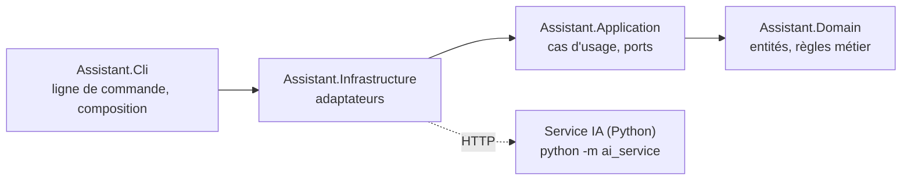

# Le découpage du fil rouge (correction de S2.1)

Ce document est la correction du gabarit de la séquence 2.1, `docs/gabarit-decoupage.md`. Il décrit
le découpage tiré du cahier des charges (`docs/cahier-des-charges.md`) : les couches et les projets
qui les portent, les entités, les ports, les frontières entre recherche, génération et orchestration,
et la place de l'index et du service IA.

La correction de S2.1, le tag `corrige/s2.1`, écrit ce découpage en code : les quatre projets et
leurs références, les entités dans `src/Assistant.Domain/Model.cs` et les ports dans
`src/Assistant.Application/Ports.cs`. Ce document les décrit tels que la séquence 2.1 les pose.

Comparez-le à votre gabarit au début de la séquence 2.2. Un écart n'est pas forcément une erreur.
Ce qui compte, c'est de savoir le justifier.

## Quatre projets et une règle de dépendance

| Projet | Ce qu'il contient | Ce qu'il référence |
|---|---|---|
| `Assistant.Domain` | les entités et les règles métier | rien |
| `Assistant.Application` | les cas d'usage, et les ports dont ils ont besoin | le domaine |
| `Assistant.Infrastructure` | les adaptateurs : lecture du corpus, découpage, index enregistré sur disque, prompts, client HTTP du service IA | l'application |
| `Assistant.Cli` | le programme lui-même : la ligne de commande, et la racine de composition qui assemble adaptateurs et cas d'usage | l'infrastructure |

Chaque projet ne référence que celui qui le suit vers l'intérieur, et voit les autres par
transitivité. Les dépendances vont donc toujours vers le domaine.

C'est le compilateur qui impose cette règle : un projet ne peut pas utiliser un type d'un projet qu'il
ne référence pas. Des dossiers dans un seul projet auraient suffi à ranger le code, mais la règle n'y
serait qu'une convention. Des tests d'architecture la vérifient en plus. Ils lisent les références
des fichiers `.csproj`, et contrôlent que le domaine ne dépend que du runtime, que l'application ne
dépend que du domaine, et que ni l'un ni l'autre ne touche au réseau. Le projet de tests référence
`Assistant.Cli`, et voit donc toutes les couches.

## Le domaine : ce que manipule le métier

Le domaine décrit des documents, des utilisateurs et des réponses sourcées. Il ne connaît ni HTTP, ni
le disque, ni aucune technologie d'IA, et il ne déclare aucune interface tournée vers l'extérieur.

| Entité | Ce qu'elle porte |
|---|---|
| `Document` | un document interne : son identifiant, son titre, son texte et les groupes autorisés à le lire |
| `Chunk` | un morceau de document, avec sa position, qui hérite des droits de son document |
| `User` | un utilisateur et ses groupes |
| `Passage` | un morceau retrouvé pour une question, avec son score de similarité |
| `Source` | une source citée : le numéro du passage, et le document et le morceau qu'il désigne |
| `AnswerStatus` | les trois issues d'une question : une réponse citée, aucune source pertinente, une réponse non sourcée |
| `Retrieved` et `AnswerTrace` | la trace d'une réponse : les passages retrouvés et leurs scores, le seuil appliqué, et ce que le modèle a produit |
| `Answer` | la réponse elle-même : la question, son statut, le texte, les sources et la trace |

La trace fait partie de la réponse, parce que le cahier des charges demande de pouvoir expliquer
chaque réponse, refus compris. Les textes des deux refus sont fixés dans le domaine, eux aussi
(`Messages`) : ils font partie du métier.

Les règles du cahier des charges ont leur place dans le domaine. Il s'agit de savoir qui peut lire
quel morceau, et ce qu'est une citation valide. Ce sont des fonctions pures, qui ne dépendent
d'aucun modèle et se testent en quelques microsecondes.

Deux exigences restent hors du domaine. Le seuil de pertinence est un réglage du cas d'usage, que la
configuration lui fournit. Les consignes de forme sont écrites dans le prompt : répondre en français,
en trois phrases au plus, en citant ses sources. Le prompt est un fichier, que l'application charge
par un port. Que la réponse cite bien ses sources, en revanche, c'est le domaine qui le vérifie.

## L'application : les cas d'usage et leurs ports

Deux cas d'usage suffisent. Le premier indexe le corpus : il charge les documents, les découpe en
morceaux, fait vectoriser les morceaux et remplace l'index. Le second répond à une question au nom
d'un utilisateur.

Les ports sont déclarés dans l'application, et non dans le domaine. Ce sont les cas d'usage qui ont
besoin d'un modèle, d'un index ou d'un fichier, pas les entités. Le domaine reste ainsi sans aucune
dépendance, pas même envers une interface. C'est la différence avec l'exemple de la séquence 1.3,
qui déclare son port dans le domaine. Chaque port est implémenté par un adaptateur de
l'infrastructure, que la racine de composition branche au démarrage. Dans les tests, chaque port peut
être remplacé par un double écrit à la main, et c'est ce qui permet de tester le cœur sans modèle.

| Port | Ce que le cas d'usage lui demande | Ce qui l'implémente |
|---|---|---|
| `IEmbedder` | transformer des textes en vecteurs. `EmbedDocuments` rend un vecteur par morceau à indexer, et `EmbedQuery` le vecteur d'une question. Le contrat du service distingue les deux, car certains modèles ne traitent pas une question comme un document. | le client HTTP du service IA |
| `IGenerator` | produire un texte à partir d'une `GenerationRequest` : les consignes, le prompt construit par l'application, la température et le nombre maximal de jetons. `Generate` rend le texte. | le client HTTP du service IA |
| `IVectorIndex` | dire s'il est construit (`IsBuilt`), remplacer tout son contenu par de nouveaux morceaux et leurs vecteurs (`Replace`), et rendre les k morceaux les plus proches d'un vecteur parmi ceux qu'accepte un prédicat (`Search`) | un index enregistré dans un fichier |
| `IDocumentSource` | charger les documents du corpus (`Load`) | la lecture des fichiers Markdown |
| `ITextSplitter` | découper un document en morceaux (`Split`) | un découpage par paragraphes |
| `IPromptRepository` | donner un modèle de prompt par son nom (`Get`). Le `PromptTemplate` rendu porte les consignes (`System`) et le message à compléter (`User`), où `Render` insère la question et les passages numérotés. | la lecture des fichiers de prompts |

## Recherche, génération et orchestration

Le cahier des charges décrit une chaîne : la recherche, la génération, puis la réponse citée. Le
découpage place une frontière entre chaque maillon, et ces frontières passent par les ports.

La recherche transforme la question en vecteur avec `IEmbedder`, puis demande à `IVectorIndex` les
morceaux les plus proches. Le cas d'usage lui passe en prédicat la règle d'accès du domaine. L'index
ne sait rien des droits : il applique le filtre qu'on lui donne, avant de retenir les k premiers. Un
passage interdit ne prend donc aucune place dans le résultat, et n'atteint jamais le prompt.

La génération reçoit un prompt déjà construit. Le modèle de prompt vient de `IPromptRepository`, et
c'est l'application qui y insère la question et les passages numérotés avant d'appeler
`IGenerator`. Le générateur ne voit que du texte. Il ne sait rien des documents, des droits ni des
citations.

L'orchestration est le cas d'usage qui répond à une question. Il refuse une question vide, lance la
recherche filtrée par les droits, puis garde les passages dont le score atteint le seuil. S'il n'en
reste aucun, il s'arrête là et refuse sans appeler le modèle. Sinon, il construit le prompt, appelle
le générateur et vérifie les citations avec la règle du domaine. Des citations absentes ou invalides
donnent une réponse non sourcée, accompagnée des passages. Quelle que soit l'issue, il remplit la
trace.

L'orchestration vit dans l'application parce qu'elle a besoin des ports. Les règles qu'elle applique
restent dans le domaine, où elles se testent sans elle.

## Où vit l'index

L'index vit du côté de l'application. C'est un adaptateur de l'infrastructure, derrière le port
`IVectorIndex`, enregistré dans un fichier du dossier `data/`, qui n'est pas versionné. Le service
IA, lui, ne fait que produire des vecteurs et du texte.

Ce choix a trois raisons. D'abord, la règle d'accès reste dans le domaine, et l'index l'applique sous
forme de prédicat, sans la connaître. Ensuite, l'application voit l'index dont elle dépend : elle sait
s'il est construit, et elle le reconstruit elle-même. Enfin, le service IA reste sans état. On peut
le redémarrer, le remplacer ou le partager entre plusieurs applications.

En contrepartie, l'application envoie tous les morceaux au service pour les vectoriser, et parcourt
tout l'index à chaque question. Pour quelques dizaines de documents, c'est sans importance.

L'option écartée consistait à placer l'index dans le service IA, avec des routes pour le remplir et
l'interroger. Les échanges seraient moins lourds. Mais le filtre d'accès, donc une règle métier,
partirait dans un composant technique, hors de portée des tests du domaine. Et l'application
dépendrait d'un index qu'elle ne voit pas.

## Où vit le service IA

Le service IA est un programme à part, écrit en Python, dans `ai_service/`. On le lance à côté de
l'application avec `python -m ai_service`. Les deux programmes ne communiquent qu'en HTTP, selon le
contrat décrit dans `docs/contrat-http.md`, et ne partagent aucun code, pas même le langage.

Dans le découpage, le service n'est pas une couche de l'application. Il est dehors, comme le serait
une base de données. Du côté de l'application, seul le client HTTP de l'infrastructure le connaît :
c'est lui qui implémente `IEmbedder` et `IGenerator`. Les particularités des modèles restent
dans le service, par exemple les préfixes qu'un modèle attend ou le moteur qui le fait tourner.
L'application, elle, déclare une intention : vectoriser une question ou un document, ou générer une
réponse.

En entreprise, les modèles tournent souvent sur des machines de calcul gérées par une autre équipe,
et l'application sur des serveurs ordinaires. Un programme à part rend cette frontière visible dans
l'architecture. Un autre langage empêche en plus de la contourner : l'application ne peut pas
importer le code du modèle, et le contrat est la seule voie. Le prix à payer, c'est un second
programme à lancer, un appel réseau à chaque question et un contrat à respecter des deux côtés.

## Ce qu'il faut retenir

Le domaine ne dépend de rien, et les cas d'usage ne connaissent que des ports. Les adaptateurs,
l'index compris, sont dans l'infrastructure, et le modèle est derrière un contrat HTTP, dans un autre
programme. Dans ce découpage, le modèle est un détail d'infrastructure : on doit pouvoir le changer
sans toucher au cœur. Le reste du cours vérifie jusqu'où cette promesse tient.
